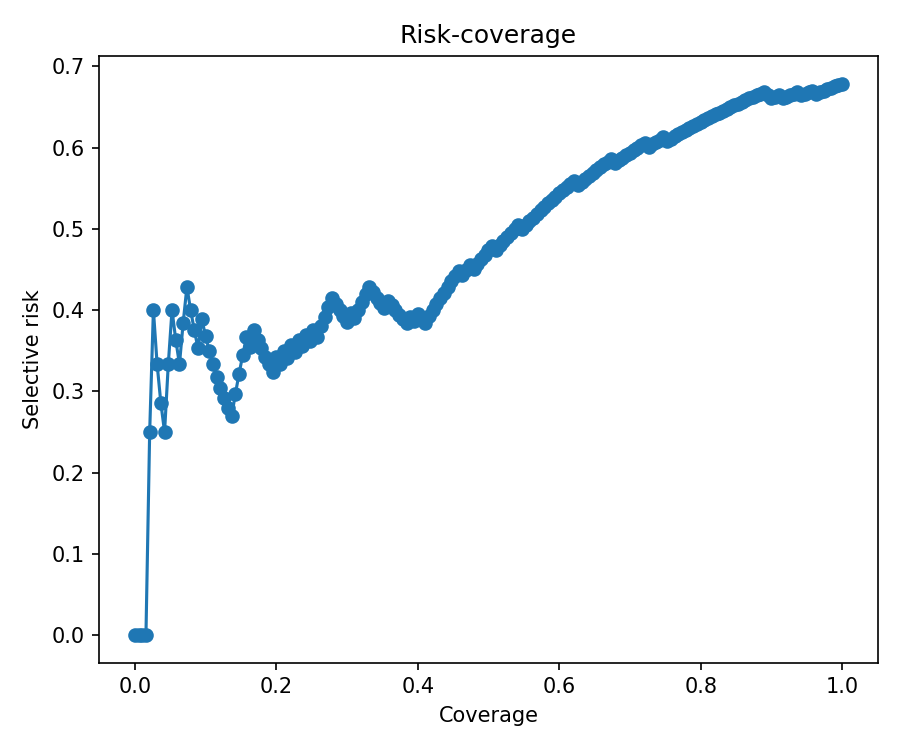

# MCP 工具路由可靠性实验室

[英文版](README.en.md)

一个基于 Python、强调可审阅证据的工具链，用于评测 MCP／智能体的工具路由器
何时应该**选择工具、澄清需求或拒绝调用**。项目将预测和策略与路由器、模型、
工具集合、查询集合及分数语义绑定，让实验结果可以复现和检查。
它不是通用聊天机器人，也不是已经上线、能够自主完成任务的智能体产品。

> **当前里程碑：V1 人工智能标注实验版。** 数据由人工智能标注，
> 尚未经过独立人工复核，也不构成生产安全认证。
> 两种被评测的路由器均未在设定的 5% 目标风险下获得可用策略。

项目包含 40 个固定版本的工具、300 条中英双语基础查询及 90 条配对变体；
按照模板意图族隔离数据划分；只在校准集拟合置信度；冻结配置后进行一次测试集评估；
策略不可用时保持拒绝执行的默认行为。测试集包括 100 条基础查询及其 90 条变体，
即 **190 条记录，而不是 190 个独立意图**。另有 112 条基础标签仍为生成器暂定结果。

| V1 冻结测试集路由器 | 首选工具准确率 | 前五候选召回率 | 可用的 5% 风险策略 |
|---|---:|---:|---|
| BM25 | 0.1737 | 0.2737 | 无 |
| 多语言 MiniLM | 0.3211 | 0.4947 | 无 |

数据和结果可见[数据集说明](data/v1-ai-experimental/DATASET_CARD.md)、
[标注来源报告](data/v1-ai-experimental/ANNOTATION_REPORT.md)，以及
[BM25](reports/v1-ai-experimental/bm25/reliability-card.md)和
[嵌入路由器](reports/v1-ai-experimental/embedding/reliability-card.md)的可靠性报告。
下文同时保留当前 V1 的详细结果和历史 V0.1 里程碑。

安装后可以按[五分钟离线演示](docs/portfolio/demo.md)快速了解评测流程。
[中文项目讲解备忘](docs/portfolio/interview-zh.md)区分了可核实的项目事实与需要自行确认的个人职责。
[发布准备与验收记录](docs/portfolio/release-preparation.md)记录了独立仓库迁移、报告来源、
验证结果和公开发布情况。



## 为什么需要拒绝调用

选择一个看似合理但实际错误的工具，可能写入错误文件、误判版本控制状态，
或向外部服务发送不完整参数。因此，一个有用的路由器需要同时具备两种能力：

1. 当请求能够直接执行时，把正确工具排在前面；
2. 当请求存在歧义或超出支持范围时，表达经过校准的不确定性。

本项目同时评测这两点，输出前若干候选排名、平均倒数排名（MRR）、布里尔分数（Brier）、
期望校准误差（ECE）、错误检测曲线下面积（AUROC）、风险—覆盖率及其曲线下面积（AURC）、
分组自助法置信区间、错误切片和风险约束策略。缺少可用的风险阈值时，策略保持不可用。

## 系统架构


代码不会向路由器传入金标准标签。置信度模型只在校准集拟合，
评估测试集前冻结配置，运行生命周期记录会检查该次运行只评估了一次测试集。

## 安装

需要 Python 3.11 或 3.12。以下示例使用 Windows PowerShell：

```powershell
py -3.11 -m venv .venv
.\.venv\Scripts\Activate.ps1
python -m pip install --upgrade pip
python -m pip install -e ".[dev,report]"
```

多语言嵌入基线还需要安装额外依赖：

```powershell
python -m pip install -e ".[embedding,report]"
```

仓库包含用于锁定环境的 `uv.lock`。嵌入模型在 `configs/embedding.yaml`
中固定了模型仓库版本；首次运行需要下载模型，缓存完整后可以离线运行。

## 五分钟离线示例

该示例规模很小，且不会下载模型。安装依赖后，BM25 示例不需要接口密钥或付费服务。
它演示评测机制，不复现下文 V1 实验分数。

```powershell
mrrl validate `
  --tools tests/fixtures/tools.jsonl `
  --queries tests/fixtures/queries.jsonl `
  --profile fixture

mrrl benchmark `
  --config configs/fixture-bm25.yaml `
  --tools tests/fixtures/tools.jsonl `
  --queries tests/fixtures/queries.jsonl `
  --run-dir runs/fixture
```

运行后打开 `runs/fixture/reliability-card.md`，并查看 `runs/fixture/figures/`
下的四张图。若输出目录已存在，请选择新的 `--run-dir`；程序不会覆盖已有运行。

## V0.1 历史实验

> **这是历史探索性里程碑，不构成生产安全声明。** 100 条作者编写的查询中，
> 只有 30 条冻结测试记录。两份导出策略均被明确标记为不可用，
> 原因为 `exploratory_v0_1`。

V0.1 包含六个易混淆领域的 20 个规范化工具，以及 100 条原创、均衡的中英双语查询。
固定划分为 40 条开发记录、30 条校准记录和 30 条测试记录。
数据来源、标注方式、组成和许可证见[数据集说明](data/DATASET_CARD.md)。

### 冻结测试结果

| 路由器 | 首选准确率 | MRR | 前五召回率 | Brier ↓ | ECE ↓ | 错误 AUROC ↑ | AURC ↓ | 测试错误数 |
|---|---:|---:|---:|---:|---:|---:|---:|---:|
| BM25 | 0.2000 | 0.2639 | 0.3667 | 0.0758 | 0.1001 | 0.9444 | 0.5144 | 24/30 |
| 多语言 MiniLM | 0.2333 | 0.3444 | 0.4667 | 0.1846 | 0.1814 | 0.7205 | 0.5768 | 23/30 |

首选准确率采用严格口径：对于需要澄清或没有匹配工具的请求，只要路由器输出了工具，
就按路由错误计算。因此，该表评测的是包含这些情况的路由行为，而不只是可执行请求的排名。
Brier、ECE 和 AURC 越低越好，错误 AUROC 越高越好。
估计仅来自 30 条测试记录，不能作为高可信度榜单结论。

经验策略和保守策略均包含：

```json
{"available": false, "threshold": null, "unavailable_reason": "exploratory_v0_1"}
```

项目不会据此宣称获得了稳定的 5% 风险阈值。

### 复现实验

```powershell
mrrl validate --tools data/tools.json --queries data/queries.jsonl --profile v0.1

mrrl benchmark `
  --config configs/bm25.yaml `
  --tools data/tools.json `
  --queries data/queries.jsonl `
  --run-dir runs/v0.1-bm25

mrrl benchmark `
  --config configs/embedding.yaml `
  --tools data/tools.json `
  --queries data/queries.jsonl `
  --run-dir runs/v0.1-embedding
```

在 Windows 11、Python 3.11、Intel Core i5-13500H（12 核／16 个逻辑处理器）、
15.7 GiB 内存、仅使用处理器的环境中，缓存就绪后的完整 BM25 命令耗时 8.659 秒，
完全离线的嵌入命令耗时 55.312 秒。时间不包含模型下载。
这是一台笔记本上的单次历史测量，不是吞吐量承诺。

## 产物目录

每次完成的运行都会以原子方式发布产物，并附带校验和：

```text
manifest.json                 来源、生命周期、版本与校验和
predictions.jsonl             路由器输出的排序候选
features.parquet              置信度特征
metrics.json                  排名、校准与选择性风险指标
policy.json                   选定的默认拒绝执行策略
policy-empirical.json         探索性经验策略
policy-conservative.json      探索性威尔逊置信上界保守策略
errors.csv                    可检查的错误案例与切片
reliability-card.md           便于阅读的可靠性报告
figures/                      校准、风险—覆盖率、方法比较与稳健性图表
```

已提交的 V0.1 产物位于 `reports/v0.1/bm25/` 和 `reports/v0.1/embedding/`。

## V1 人工智能标注实验版：尚未经过人工复核

`data/v1-ai-experimental/` 是基于 V1 候选数据及两份人工智能完成的标注表构建的
可复现实验快照。它包含 40 个工具、300 条中英双语基础查询及 90 条变体，
开发集、校准集和测试集各有 100 条基础查询。
它**不是稳定 V1.0，不是独立人工复核结果，也不构成生产安全声明**。
原始标注表在 `raw/` 下按原始字节保留；52 条决策和 15 条次级事后修订与原始文件分开保存。

[数据集说明](data/v1-ai-experimental/DATASET_CARD.md)解释了来源及按模板意图族划分的规则。
[标注报告](data/v1-ai-experimental/ANNOTATION_REPORT.md)分别记录了
45 条文本相同的人工智能之间比较、40 条文本相同的生成器与人工智能比较，
以及 100 行事后描述性一致情况。300 条最终基础标签中，112 条仍是生成器暂定结果。
这些比较都不被描述为独立、盲审的人工一致性评价。

### 冻结测试结果

测试集包括 100 条基础查询及其 90 条配对变体，共 190 条记录。
对需要澄清或没有匹配工具的请求直接输出工具，会按首选准确率的严格口径算错。

| 路由器 | 首选准确率 | MRR | 前五召回率 | Brier ↓ | ECE ↓ | 错误 AUROC ↑ | AURC ↓ | 可用的 5% 风险策略 |
|---|---:|---:|---:|---:|---:|---:|---:|---|
| BM25 | 0.1737 | 0.2125 | 0.2737 | 0.1120 | 0.0711 | 0.8722 | 0.6364 | 无 |
| 多语言 MiniLM | 0.3211 | 0.3932 | 0.4947 | 0.1959 | 0.1159 | 0.7749 | 0.4833 | 无 |

两份报告使用相同的工具集合哈希：
`sha256:8983296fa7cc6343c94a11fe15307e87f3bf5c6f03bcd036e971b9e9e18de069`，
以及查询集合哈希：
`sha256:3e5f030f545dad8386ae98e688d81d16640fe03c7b5838291f9baa5741b7b478`。

[BM25 报告](reports/v1-ai-experimental/bm25/reliability-card.md)和
[嵌入报告](reports/v1-ai-experimental/embedding/reliability-card.md)包含风险、错误与限制细节。
例如，嵌入路由器在 `v01_q_015` 上把 `git.show` 排在金标准 `git.log` 前面，
虽然请求要的是提交历史列表，而非单个补丁；它还对不支持的天气查询和海报生成请求输出候选。
这些结果暴露了局限，并不证明路由器可以安全部署。

带编号的场景模板按完整意图族分配，避免了已记录规范化规则下的跨集碰撞，
但这不能证明所有语义改写都被隔离。90 条测试变体共享 30 个基础意图，
所以 190 条记录不是 190 个独立意图。

### 配对稳健性

每条变体都与它自己的测试集基础查询比较，使用冻结的路由输出和仅在校准集拟合的置信度模型。
不根据测试集重新拟合模型或调节策略。全部 90 对均参与计算：
同义改写、跨语言改写和噪声扰动各 30 对。

| 条件 | 配对数 | BM25 首选翻转率 | MiniLM 首选翻转率 |
|---|---:|---:|---:|
| 总体 | 90 | 0.3667 | 0.4000 |
| 同义改写 | 30 | 0.1667 | 0.3000 |
| 跨语言改写 | 30 | 0.9333 | 0.5333 |
| 噪声扰动 | 30 | 0.0000 | 0.3667 |

首选翻转表示返回的首选工具发生变化，不直接表示正确性改善或下降。
两种路由器的总体平均准确率变化都是 0.0000；
BM25 和 MiniLM 的平均置信度变化分别为 +0.0611 和 +0.0413。
所有变化均按**变体减基础**计算。
各扰动条件的变化和全部 90 条配对差值保存在每份报告的 `metrics.json` 中。

决策翻转率为**不可用**（`not_available`），而不是零：
两种选定的 5% 风险策略都没有可用决策阈值。
这些配对复用了 30 个基础意图，不能当作 90 个独立实验。

### 复现本次实验

使用 Python 3.11／3.12 和上面的安装步骤；第二种基线需要额外安装嵌入依赖。
数据构建器拒绝覆盖已有快照；验证重新生成时，请使用新的输出位置。

```powershell
python scripts/build_v1_ai_experimental.py --output runs/v1-ai-rebuilt
python scripts/report_v1_ai_annotations.py
mrrl validate --tools data/v1-ai-experimental/tools.json `
  --queries data/v1-ai-experimental/queries.jsonl --profile ai-experimental
mrrl benchmark --config configs/v1-ai-bm25.yaml `
  --tools data/v1-ai-experimental/tools.json `
  --queries data/v1-ai-experimental/queries.jsonl `
  --run-dir runs/v1-ai-bm25
mrrl benchmark --config configs/v1-ai-embedding.yaml `
  --tools data/v1-ai-experimental/tools.json `
  --queries data/v1-ai-experimental/queries.jsonl `
  --run-dir runs/v1-ai-embedding
```

已提交报告在 Windows、Python 3.11 环境中，使用固定版本的多语言 MiniLM，
从干净源码提交 `6319120606b19f34802d0c9cad4dbf65866921cd` 重新生成。
嵌入运行使用两个处理器线程；设置和已观察到的数值微小差异见
[发布验收记录](docs/portfolio/release-preparation.md)。
这些是合成案例上的单次运行，不是按真实流量加权的性能估计。

## V1.0 候选数据：等待人工复核

`data/v1-candidate/` 是按生产配置校验规则构建的确定性候选数据，
包含 40 个工具、300 条中英双语基础查询和 90 条分组扰动变体。
它不是稳定 V1.0，也不替代原有 V0.1 文件。
发布门槛仍要求一位真实的独立复核者完成盲审的 100 条查询任务，
并由主要作者复查全部 180 条需要澄清、困难负例及无匹配工具的基础查询。

```powershell
python scripts/build_v1_candidate.py

mrrl validate `
  --tools data/v1-candidate/tools.json `
  --queries data/v1-candidate/queries.jsonl `
  --profile production
```

交接、冻结、一致性评价、复查和仲裁的具体命令位于
`data/v1-candidate/ANNOTATION_HANDOFF.md`。
导入命令会拒绝缺失行、修改过的查询文本、未知工具、错误的工具集合哈希、
非独立的第二份标注，以及覆盖已冻结原始产物的尝试。
“生产配置”只是校验规则名称，不代表数据已完成人工复核或可以安全部署。

## 评测外部路由器

每条查询导出一行符合 `1.1` 版本结构的预测，包含有序候选、分数语义、
延迟或错误信息，以及精确的工具集合哈希和查询集合哈希。
评测前先通过来源检查：

```powershell
mrrl import-predictions `
  --input external-predictions.jsonl `
  --tools data/tools.json `
  --queries data/queries.jsonl `
  --output runs/external-normalized.jsonl

mrrl evaluate `
  --predictions runs/external-normalized.jsonl `
  --tools data/tools.json `
  --queries data/queries.jsonl `
  --run-dir runs/external
```

工具集合哈希、查询哈希、工具标识、查询标识、分数方向或候选排名不匹配时，
程序会在计算指标之前拒绝输入。

## 局限性

以下前五项描述历史 V0.1 数据；V1 人工智能标注实验版的限制另见上文：

- V0.1 查询由作者编写，带有明显模板特征，不是从真实智能体生产流量中抽样得到。
- V0.1 的 25／25／25／25 均衡类别比例不同于真实部署，
  类别先验或查询分布变化时，置信度概率和阈值也会变化。
- V0.1 只有一份主要标注。独立盲审人工复核仍是稳定 V1.0 的门槛。
- V0.1 没有扰动变体，也没有测量未见工具的冷启动能力。
- V0.1 的已知工具集合包含同一上游仓库的 20 个工具；结果不能自动推广到其他工具结构、
  路由器、语言或模型。当前 V1 虽扩大到 40 个工具，也不构成普遍适用性证明。
- 原因提示只是诊断信息，不是金标准解释或安全保证。

## 许可证

项目代码采用 Apache-2.0 许可证（`LICENSE`）。
原创查询、标注、文档和原创规范化描述采用 CC BY 4.0（`DATA_LICENSE`）。
上游工具结构的来源和保留的许可证逐行记录在 `data/sources.csv` 中。
V0.1 使用固定版本的 `modelcontextprotocol/servers`，
并明确记录了其 Apache-2.0／MIT 许可证过渡情况。

## 后续计划

- 完成独立盲审的第二份标注及 180 条主要复查，保留并仲裁全部标签分歧。
- 比较导入的生产路由器预测，不降低来源校验要求。
- 固定 V1.0 的哈希，重新运行全部基线，并在完整验收条件满足后发布。
  Python 3.11／3.12 的持续集成已覆盖代码风格、类型、测试、确定性候选数据重建、
  生产配置校验和离线评测。
