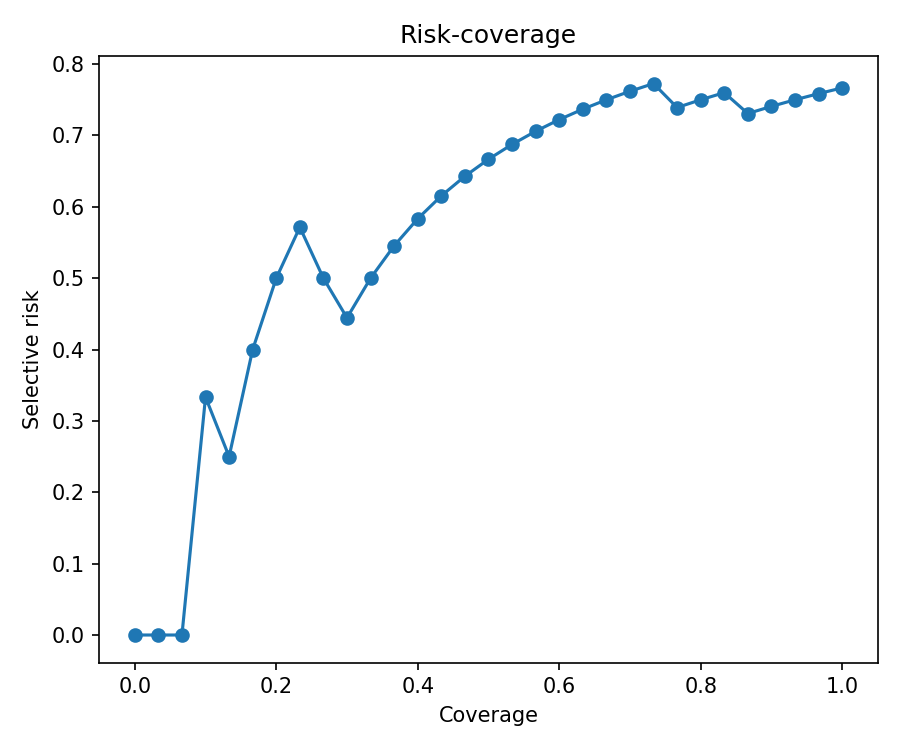
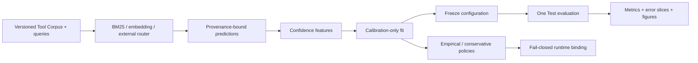

# MCP Route Reliability Lab

An evaluation-first Python toolkit for measuring whether an MCP/agent tool router
should **route, clarify, or abstain**. It binds every prediction and policy to the
exact router, model, Tool Corpus, feature version, and score semantics that produced
it, then publishes reproducible reliability artifacts instead of a single accuracy
number.

> **V0.1 is an exploratory portfolio milestone, not a production safety claim.**
> Its 100 author-created queries include only 30 frozen Test cases. Both exported
> policies are deliberately unavailable with reason `exploratory_v0_1`.



## Why abstention matters

Selecting a plausible but wrong tool can write the wrong file, inspect the wrong Git
state, or send incomplete arguments to an external service. A useful router therefore
needs two capabilities:

1. rank the right tool when the request is actionable; and
2. expose calibrated uncertainty when the request is ambiguous or unsupported.

This project evaluates both. It reports Top-K ranking, MRR, Brier score, ECE, error
AUROC, risk-coverage/AURC, grouped bootstrap intervals, error slices, and
risk-controlled policy artifacts. A missing safe operating point fails closed.

## Architecture



The code never passes gold labels into a router. Calibration is fitted only on the
Calibration split, configuration is frozen before Test, and the lifecycle record
asserts that Test was evaluated once.

## Installation

Python 3.11 or 3.12 is required.

```powershell
py -3.11 -m venv .venv
.\.venv\Scripts\Activate.ps1
python -m pip install --upgrade pip
python -m pip install -e ".[dev,report]"
```

For the multilingual embedding baseline:

```powershell
python -m pip install -e ".[embedding,report]"
```

`uv.lock` is checked in for a locked environment. The embedding model is pinned by
repository revision in `configs/embedding.yaml`; its first run downloads the model,
while later runs can be fully offline.

## Five-minute offline fixture demo

The fixture is deliberately small and never downloads a model.

```powershell
mrrl validate `
  --tools tests/fixtures/tools.jsonl `
  --queries tests/fixtures/queries.jsonl `
  --profile fixture

mrrl benchmark `
  --config configs/fixture-bm25.yaml `
  --tools tests/fixtures/tools.jsonl `
  --queries tests/fixtures/queries.jsonl `
  --run-dir runs/fixture
```

Open `runs/fixture/reliability-card.md` and the four figures under
`runs/fixture/figures/`.

## V0.1 benchmark

V0.1 contains 20 normalized tools from six confusable domains and 100 original,
balanced Chinese/English queries. The fixed split is 40 Development / 30 Calibration
/ 30 Test. See [the Dataset Card](data/DATASET_CARD.md) for provenance, annotation,
composition, and licensing.

### Frozen Test results

| Router | Top-1 | MRR | Recall@5 | Brier ↓ | ECE ↓ | Error AUROC ↑ | AURC ↓ | Test errors |
|---|---:|---:|---:|---:|---:|---:|---:|---:|
| BM25 | 0.2000 | 0.2639 | 0.3667 | 0.0758 | 0.1001 | 0.9444 | 0.5144 | 24/30 |
| Multilingual MiniLM | 0.2333 | 0.3444 | 0.4667 | 0.1846 | 0.1814 | 0.7205 | 0.5768 | 23/30 |

Top-1 is strict: every Clarify or No-match case counts as a routing error if the
router emits a tool. The table therefore evaluates safe routing behavior rather than
ranking only the actionable subset. Lower Brier, ECE, and AURC are better; higher
Error AUROC is better. These estimates come from only 30 Test cases and are not
leaderboard-grade conclusions.

Both the empirical and conservative policies contain:

```json
{"available": false, "threshold": null, "unavailable_reason": "exploratory_v0_1"}
```

No stable 5% risk threshold is advertised.

### Reproduce the runs

```powershell
mrrl validate --tools data/tools.json --queries data/queries.jsonl --profile v0.1

mrrl benchmark `
  --config configs/bm25.yaml `
  --tools data/tools.json `
  --queries data/queries.jsonl `
  --run-dir runs/v0.1-bm25

mrrl benchmark `
  --config configs/embedding.yaml `
  --tools data/tools.json `
  --queries data/queries.jsonl `
  --run-dir runs/v0.1-embedding
```

Measured on Windows 11, Python 3.11, an Intel Core i5-13500H (12 cores / 16 logical
processors), 15.7 GiB RAM, CPU only: the complete warm-cache BM25 command took
8.659 s and the fully offline embedding command took 55.312 s. Model download time
is excluded. Measurements are single runs on one laptop, not throughput claims.

## Artifact layout

Each completed run is atomically published with checksums:

```text
manifest.json                 provenance, lifecycle, versions, checksums
predictions.jsonl             ranked router output
features.parquet              confidence features
metrics.json                  ranking, calibration, selective-risk metrics
policy.json                   selected fail-closed policy
policy-empirical.json         exploratory empirical policy
policy-conservative.json      exploratory Wilson-UCB policy
errors.csv                    inspectable failure cases and slices
reliability-card.md           human-readable result card
figures/                      reliability, risk-coverage, method, robustness PNGs
```

Checked-in V0.1 artifacts live under `reports/v0.1/bm25/` and
`reports/v0.1/embedding/`.

## V1.0 candidate data — human review pending

`data/v1-candidate/` is a deterministic, production-profile candidate with 40
tools, 300 bilingual base queries, and 90 grouped perturbation variants. It is not a
stable V1.0 release and does not replace the canonical V0.1 files. The release gate
still requires a real second human to complete the blinded 100-query assignment and
the primary author to recheck all 180 Clarify, Hard Negative, and No-match bases.

```powershell
python scripts/build_v1_candidate.py

mrrl validate `
  --tools data/v1-candidate/tools.json `
  --queries data/v1-candidate/queries.jsonl `
  --profile production
```

The exact handoff, freeze, agreement, recheck, and adjudication commands are in
`data/v1-candidate/ANNOTATION_HANDOFF.md`. Import commands reject missing rows,
modified query text, unknown tools, incorrect corpus hashes, non-independent second
labels, and attempts to overwrite frozen raw artifacts.

## Evaluate an external router

Export one schema `1.1` JSONL prediction per query, including ordered candidates,
score semantics, latency/error, the exact Tool Corpus hash, and query-set hash. Then
run the provenance gate before evaluation:

```powershell
mrrl import-predictions `
  --input external-predictions.jsonl `
  --tools data/tools.json `
  --queries data/queries.jsonl `
  --output runs/external-normalized.jsonl

mrrl evaluate `
  --predictions runs/external-normalized.jsonl `
  --tools data/tools.json `
  --queries data/queries.jsonl `
  --run-dir runs/external
```

Mismatched corpus hashes, query hashes, tool IDs, query IDs, score direction, or
candidate ranks are rejected before metrics are computed.

## Limitations

- V0.1 queries are author-created and visibly templated; they are not sampled from
  production agent traffic.
- The balanced 25/25/25/25 case prior differs from real deployments, so confidence
  probabilities and thresholds will shift under a different prior.
- There is one primary annotation only. Independent blinded review is a V1.0 gate.
- V0.1 has no perturbation variants and does not measure unseen-tool cold start.
- The known Tool Corpus contains 20 tools from one upstream repository; results do
  not generalize automatically to other schemas, routers, languages, or models.
- Reason hints are diagnostics, not ground-truth explanations or safety guarantees.

## Licenses

The Python project is Apache-2.0 (`LICENSE`). Original queries, annotations,
documentation, and original normalized descriptions are CC BY 4.0 (`DATA_LICENSE`).
Upstream Tool Schema provenance and retained licenses are recorded per row in
`data/sources.csv`; V0.1 uses the pinned `modelcontextprotocol/servers` revision and
records its Apache-2.0/MIT transition explicitly.

## Roadmap

- Complete the blinded second annotation and 180-query primary recheck, then retain
  and adjudicate every label disagreement.
- Compare imported production routers without weakening provenance gates.
- Freeze V1.0 hashes, rerun all baselines, and publish only after the full definition
  of done passes. Python 3.11/3.12 CI already covers lint, types, tests, deterministic
  candidate regeneration, production-profile validation, and an offline benchmark.
