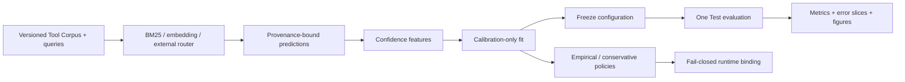

# MCP Route Reliability Lab

[中文说明](#中文说明) · [English overview](#english-overview)

## 中文说明

MCP Route Reliability Lab 是一个基于 Python 的 **Agent 工具路由可靠性评测工具链**。
它研究的不只是“应该选择哪个工具”，还包括“什么时候应该澄清需求或拒绝调用”，
让工具选择错误、置信度和风险边界都能被检查与复现。
它不是通用聊天机器人，也不是已经上线、能够自主完成任务的 Agent 产品。

### 主要功能

- **统一评测输入：** 固定工具描述、查询及标签，使用哈希绑定工具集合、预测与策略，
  在评测前拒绝来源或格式不匹配的输入。
- **比较路由基线：** 支持 BM25、多语言 MiniLM 嵌入模型，以及导入外部路由器的预测结果。
- **置信度校准与风险策略：** 仅在 Calibration（校准集）拟合置信度并选择阈值，
  冻结配置后评估 Test（测试集）；没有满足约束的阈值时，明确标记策略不可用。
- **输出可审阅证据：** 生成排名、校准、风险—覆盖率与配对稳健性指标，
  保存错误样本、图表、可靠性报告和带校验和的运行清单。

### 当前实验与限制

当前 **V1 AI 实验版**包含 40 个工具、300 条中英双语基础查询和 90 条配对变体。
Test 集由 100 条基础查询及 90 条变体组成，共 190 条记录；变体复用 30 个基础意图，
**不能将这些记录当作 190 个独立意图**。

| 路由器 | Top-1 准确率 | Recall@5 | 整体 Top-1 翻转率 | 可用的 5% 风险策略 |
|---|---:|---:|---:|---|
| BM25 | 0.1737 | 0.2737 | 0.3667 | 无 |
| 多语言 MiniLM | 0.3211 | 0.4947 | 0.4000 | 无 |

Top-1 翻转率表示变体与其基础查询返回的首选工具不同，并不直接表示准确率改善或下降。
两种路由器都没有可用的 5% 风险策略，因此决策翻转率为 `not_available`，而不是 0。

> 数据标注来自 AI，尚未经过独立人工复核，另有 112 条基础标签仍为生成器暂定结果。
> 本项目不是稳定 V1.0，也不提供生产安全认证或“已达到 5% 风险保证”的结论。

### 快速体验

需要 Python 3.11 或 3.12。以下命令在仓库根目录的 Windows PowerShell 中运行：

```powershell
python -m venv .venv
.\.venv\Scripts\Activate.ps1
python -m pip install -e ".[dev,report]"

mrrl validate --tools tests/fixtures/tools.jsonl `
  --queries tests/fixtures/queries.jsonl --profile fixture
mrrl benchmark --config configs/fixture-bm25.yaml `
  --tools tests/fixtures/tools.jsonl `
  --queries tests/fixtures/queries.jsonl `
  --run-dir runs/fixture-zh
```

安装依赖后，这个小型 BM25 示例不需要模型下载、API Key 或付费服务。
它只演示评测流程，不复现上表的 V1 分数。运行后查看
`runs/fixture-zh/reliability-card.md` 及 `figures/` 下的图表；如果输出目录已存在，
请换一个新的 `--run-dir`，程序不会覆盖已有运行。

更多细节见 [离线演示指南](docs/portfolio/demo.md)、
[中文项目讲解备忘](docs/portfolio/interview-zh.md)、
[数据来源与限制](data/v1-ai-experimental/DATASET_CARD.md)，以及
[BM25 报告](reports/v1-ai-experimental/bm25/reliability-card.md)和
[MiniLM 报告](reports/v1-ai-experimental/embedding/reliability-card.md)。

## English overview

An evidence-first Python toolkit for evaluating whether an MCP/Agent tool router
should **route, clarify, or abstain**. It binds predictions and policies to their
router, model, Tool Corpus, query set, and score semantics so a result can be
reproduced and challenged.

> **Latest milestone: V1 AI experimental.** This dataset is AI-annotated,
> not independently human-reviewed, and not a production safety certification.
> Both evaluated routers failed to produce a usable policy at the configured 5%
> target risk.

The engineering case: 40 versioned tools, 300 bilingual base queries, and 90
paired variants; template-family isolation across splits; calibration fitted only
on Calibration; one frozen Test evaluation; and fail-closed policy artifacts. Test
contains 100 bases plus their 90 variants, **190 records rather than 190
independent intents**. Another 112 base labels remain generator-provisional.

| Frozen V1 Test router | Top-1 | Recall@5 | Usable 5% policy |
|---|---:|---:|---|
| BM25 | 0.1737 | 0.2737 | No |
| Multilingual MiniLM | 0.3211 | 0.4947 | No |

Explore the [Dataset Card](data/v1-ai-experimental/DATASET_CARD.md),
[annotation provenance](data/v1-ai-experimental/ANNOTATION_REPORT.md), and the
[BM25](reports/v1-ai-experimental/bm25/reliability-card.md) and
[embedding](reports/v1-ai-experimental/embedding/reliability-card.md)
reliability cards. The detailed V1 results and the historical V0.1 milestone are
below.

For a quick walkthrough, follow the [offline five-minute demo](docs/portfolio/demo.md)
after installation. The [Chinese interview brief](docs/portfolio/interview-zh.md)
separates verifiable project facts from personal contributions you must confirm.
The [local release checklist](docs/portfolio/release-preparation.md) records the
isolated Git history, report provenance, verification, and remaining publication step.


## Why abstention matters

Selecting a plausible but wrong tool can write the wrong file, inspect the wrong Git
state, or send incomplete arguments to an external service. A useful router therefore
needs two capabilities:

1. rank the right tool when the request is actionable; and
2. expose calibrated uncertainty when the request is ambiguous or unsupported.

This project evaluates both. It reports Top-K ranking, MRR, Brier score, ECE, error
AUROC, risk-coverage/AURC, grouped bootstrap intervals, error slices, and
risk-controlled policy artifacts. A missing safe operating point fails closed.

## Architecture



The code never passes gold labels into a router. Calibration is fitted only on the
Calibration split, configuration is frozen before Test, and the lifecycle record
asserts that Test was evaluated once.

## Installation

Python 3.11 or 3.12 is required.

```powershell
py -3.11 -m venv .venv
.\.venv\Scripts\Activate.ps1
python -m pip install --upgrade pip
python -m pip install -e ".[dev,report]"
```

For the multilingual embedding baseline:

```powershell
python -m pip install -e ".[embedding,report]"
```

`uv.lock` is checked in for a locked environment. The embedding model is pinned by
repository revision in `configs/embedding.yaml`; its first run downloads the model,
while later runs can be fully offline.

## Five-minute offline fixture demo

The fixture is deliberately small and never downloads a model.

```powershell
mrrl validate `
  --tools tests/fixtures/tools.jsonl `
  --queries tests/fixtures/queries.jsonl `
  --profile fixture

mrrl benchmark `
  --config configs/fixture-bm25.yaml `
  --tools tests/fixtures/tools.jsonl `
  --queries tests/fixtures/queries.jsonl `
  --run-dir runs/fixture
```

Open `runs/fixture/reliability-card.md` and the four figures under
`runs/fixture/figures/`.

## V0.1 benchmark

> **Historical exploratory milestone, not a production safety claim.** Its 100
> author-created queries include only 30 frozen Test cases. Both exported policies
> are deliberately unavailable with reason `exploratory_v0_1`.

V0.1 contains 20 normalized tools from six confusable domains and 100 original,
balanced Chinese/English queries. The fixed split is 40 Development / 30 Calibration
/ 30 Test. See [the Dataset Card](data/DATASET_CARD.md) for provenance, annotation,
composition, and licensing.

### Frozen Test results

| Router | Top-1 | MRR | Recall@5 | Brier ↓ | ECE ↓ | Error AUROC ↑ | AURC ↓ | Test errors |
|---|---:|---:|---:|---:|---:|---:|---:|---:|
| BM25 | 0.2000 | 0.2639 | 0.3667 | 0.0758 | 0.1001 | 0.9444 | 0.5144 | 24/30 |
| Multilingual MiniLM | 0.2333 | 0.3444 | 0.4667 | 0.1846 | 0.1814 | 0.7205 | 0.5768 | 23/30 |

Top-1 is strict: every Clarify or No-match case counts as a routing error if the
router emits a tool. The table therefore evaluates safe routing behavior rather than
ranking only the actionable subset. Lower Brier, ECE, and AURC are better; higher
Error AUROC is better. These estimates come from only 30 Test cases and are not
leaderboard-grade conclusions.

Both the empirical and conservative policies contain:

```json
{"available": false, "threshold": null, "unavailable_reason": "exploratory_v0_1"}
```

No stable 5% risk threshold is advertised.

### Reproduce the runs

```powershell
mrrl validate --tools data/tools.json --queries data/queries.jsonl --profile v0.1

mrrl benchmark `
  --config configs/bm25.yaml `
  --tools data/tools.json `
  --queries data/queries.jsonl `
  --run-dir runs/v0.1-bm25

mrrl benchmark `
  --config configs/embedding.yaml `
  --tools data/tools.json `
  --queries data/queries.jsonl `
  --run-dir runs/v0.1-embedding
```

Measured on Windows 11, Python 3.11, an Intel Core i5-13500H (12 cores / 16 logical
processors), 15.7 GiB RAM, CPU only: the complete warm-cache BM25 command took
8.659 s and the fully offline embedding command took 55.312 s. Model download time
is excluded. Measurements are single runs on one laptop, not throughput claims.

## Artifact layout

Each completed run is atomically published with checksums:

```text
manifest.json                 provenance, lifecycle, versions, checksums
predictions.jsonl             ranked router output
features.parquet              confidence features
metrics.json                  ranking, calibration, selective-risk metrics
policy.json                   selected fail-closed policy
policy-empirical.json         exploratory empirical policy
policy-conservative.json      exploratory Wilson-UCB policy
errors.csv                    inspectable failure cases and slices
reliability-card.md           human-readable result card
figures/                      reliability, risk-coverage, method, robustness PNGs
```

Checked-in V0.1 artifacts live under `reports/v0.1/bm25/` and
`reports/v0.1/embedding/`.

## V1 AI experimental — not human-reviewed

`data/v1-ai-experimental/` is a reproducible **AI experimental** snapshot built
from the V1 candidate and two AI-completed CSVs. It has 40 tools, 300 bilingual
base queries, 90 variants, and 100 bases per Development/Calibration/Test split.
It is **not** stable V1.0, independent human review, or a production safety
claim. The original CSVs remain byte-for-byte under `raw/`; the 52 decisions
and 15 secondary post-hoc revisions are separate from those raw files.

The [Dataset Card](data/v1-ai-experimental/DATASET_CARD.md) explains the
provenance and template-family split rule. The [annotation report](data/v1-ai-experimental/ANNOTATION_REPORT.md)
separates 45 same-text AI-vs-AI comparisons, 40 same-text generator-vs-AI
comparisons, and 100-row post-hoc descriptive concordance. Of 300 final base
labels, 112 remain generator-provisional. No comparison is presented as
independent blinded human agreement.

### Frozen Test results

The Test set has 100 bases and their 90 paired variants (190 records). Top-1
counts Clarify and No-match cases as errors when a tool is emitted.

| Router | Top-1 | MRR | Recall@5 | Brier ↓ | ECE ↓ | Error AUROC ↑ | AURC ↓ | Usable 5% policy |
|---|---:|---:|---:|---:|---:|---:|---:|---|
| BM25 | 0.1737 | 0.2125 | 0.2737 | 0.1120 | 0.0711 | 0.8722 | 0.6364 | No |
| Multilingual MiniLM | 0.3211 | 0.3932 | 0.4947 | 0.1959 | 0.1159 | 0.7749 | 0.4833 | No |

Both reports use Tool Corpus hash
`sha256:8983296fa7cc6343c94a11fe15307e87f3bf5c6f03bcd036e971b9e9e18de069`
and query-set hash
`sha256:3e5f030f545dad8386ae98e688d81d16640fe03c7b5838291f9baa5741b7b478`.
The [BM25 card](reports/v1-ai-experimental/bm25/reliability-card.md) and
[embedding card](reports/v1-ai-experimental/embedding/reliability-card.md)
contain risk, error, and limitation details. For example, the embedding router
ranked `git.show` above the gold `git.log` on `v01_q_015` ("Give a commit history
list, not one patch"); it also emitted candidates for unsupported weather and
poster-generation requests. The results expose limitations; they do not make
the router safe to deploy.

Numbered scenario templates were assigned as whole intent families, avoiding
cross-split collisions under the documented normalization. This does not prove
that all semantic paraphrases are isolated. The 90 Test variants share 30 base
intents, so 190 records are not 190 independent intents.

### Paired robustness

Each variant is compared with its own Test base, using the frozen routing outputs
and Calibration-fitted confidence model. No Test-based fitting or policy tuning is
performed. All 90 pairs are present: 30 paraphrase, 30 cross-language, and 30 noise.

| Condition | Pairs | BM25 Top-1 flip | MiniLM Top-1 flip |
|---|---:|---:|---:|
| Overall | 90 | 0.3667 | 0.4000 |
| Paraphrase | 30 | 0.1667 | 0.3000 |
| Cross-language | 30 | 0.9333 | 0.5333 |
| Noise | 30 | 0.0000 | 0.3667 |

Top-1 flip means the returned tool changed; it does not by itself mean correctness
improved or worsened. Overall mean accuracy shift is 0.0000 for both routers;
mean confidence shift is +0.0611 for BM25 and +0.0413 for MiniLM. Shifts are
**variant minus base**. Per-condition shifts and all 90 deltas are in each report's
`metrics.json`. Decision flip is **not_available**, not zero: neither selected
5% policy supplies a usable decision threshold. The pairs reuse 30 base intents,
so they are not 90 independent experiments.

### Reproduce this experiment

Use Python 3.11/3.12 and the installation instructions above, including the
embedding extra for the second run. The builder refuses to overwrite an
existing snapshot; build into a fresh location when verifying regeneration.

```powershell
python scripts/build_v1_ai_experimental.py --output runs/v1-ai-rebuilt
python scripts/report_v1_ai_annotations.py
mrrl validate --tools data/v1-ai-experimental/tools.json `
  --queries data/v1-ai-experimental/queries.jsonl --profile ai-experimental
mrrl benchmark --config configs/v1-ai-bm25.yaml `
  --tools data/v1-ai-experimental/tools.json `
  --queries data/v1-ai-experimental/queries.jsonl `
  --run-dir runs/v1-ai-bm25
mrrl benchmark --config configs/v1-ai-embedding.yaml `
  --tools data/v1-ai-experimental/tools.json `
  --queries data/v1-ai-experimental/queries.jsonl `
  --run-dir runs/v1-ai-embedding
```

The checked-in reports were regenerated from clean source commit
`6319120606b19f34802d0c9cad4dbf65866921cd` on Windows with Python 3.11 and the
pinned multilingual MiniLM revision. The embedding run used two CPU threads;
see the [release checklist](docs/portfolio/release-preparation.md) for settings
and the observed numerical drift. These are single runs on synthetic cases, not
traffic-weighted performance estimates.

## V1.0 candidate data — human review pending

`data/v1-candidate/` is a deterministic, production-profile candidate with 40
tools, 300 bilingual base queries, and 90 grouped perturbation variants. It is not a
stable V1.0 release and does not replace the canonical V0.1 files. The release gate
still requires a real second human to complete the blinded 100-query assignment and
the primary author to recheck all 180 Clarify, Hard Negative, and No-match bases.

```powershell
python scripts/build_v1_candidate.py

mrrl validate `
  --tools data/v1-candidate/tools.json `
  --queries data/v1-candidate/queries.jsonl `
  --profile production
```

The exact handoff, freeze, agreement, recheck, and adjudication commands are in
`data/v1-candidate/ANNOTATION_HANDOFF.md`. Import commands reject missing rows,
modified query text, unknown tools, incorrect corpus hashes, non-independent second
labels, and attempts to overwrite frozen raw artifacts.

## Evaluate an external router

Export one schema `1.1` JSONL prediction per query, including ordered candidates,
score semantics, latency/error, the exact Tool Corpus hash, and query-set hash. Then
run the provenance gate before evaluation:

```powershell
mrrl import-predictions `
  --input external-predictions.jsonl `
  --tools data/tools.json `
  --queries data/queries.jsonl `
  --output runs/external-normalized.jsonl

mrrl evaluate `
  --predictions runs/external-normalized.jsonl `
  --tools data/tools.json `
  --queries data/queries.jsonl `
  --run-dir runs/external
```

Mismatched corpus hashes, query hashes, tool IDs, query IDs, score direction, or
candidate ranks are rejected before metrics are computed.

## Limitations

- V0.1 queries are author-created and visibly templated; they are not sampled from
  production agent traffic.
- The balanced 25/25/25/25 case prior differs from real deployments, so confidence
  probabilities and thresholds will shift under a different prior.
- There is one primary annotation only. Independent blinded review is a V1.0 gate.
- V0.1 has no perturbation variants and does not measure unseen-tool cold start.
- The known Tool Corpus contains 20 tools from one upstream repository; results do
  not generalize automatically to other schemas, routers, languages, or models.
- Reason hints are diagnostics, not ground-truth explanations or safety guarantees.

## Licenses

The Python project is Apache-2.0 (`LICENSE`). Original queries, annotations,
documentation, and original normalized descriptions are CC BY 4.0 (`DATA_LICENSE`).
Upstream Tool Schema provenance and retained licenses are recorded per row in
`data/sources.csv`; V0.1 uses the pinned `modelcontextprotocol/servers` revision and
records its Apache-2.0/MIT transition explicitly.

## Roadmap

- Complete the blinded second annotation and 180-query primary recheck, then retain
  and adjudicate every label disagreement.
- Compare imported production routers without weakening provenance gates.
- Freeze V1.0 hashes, rerun all baselines, and publish only after the full definition
  of done passes. Python 3.11/3.12 CI already covers lint, types, tests, deterministic
  candidate regeneration, production-profile validation, and an offline benchmark.
