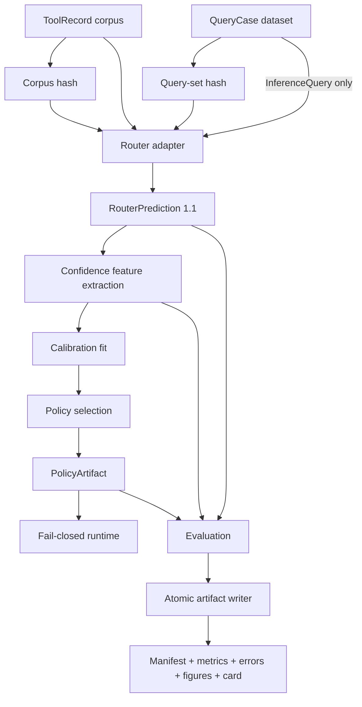
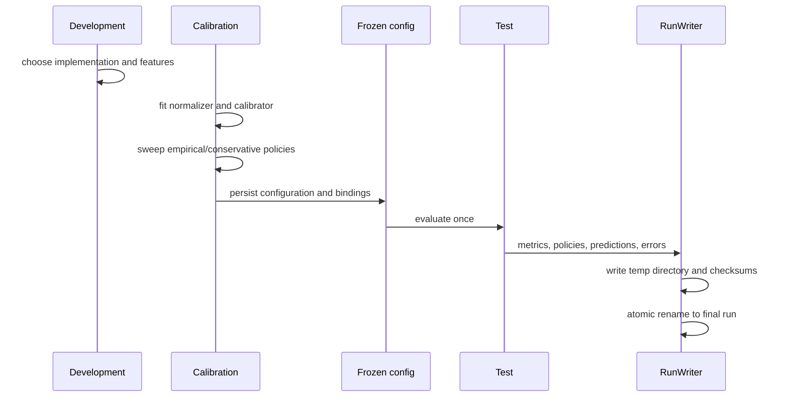

# Architecture

MCP Route Reliability Lab separates routing, confidence estimation, policy selection,
runtime enforcement, and reporting so each layer can be tested and replaced without
leaking labels or silently invalidating a threshold.

## System boundary

The benchmark starts after a user request has been reduced to text and before an
agent executes a tool. It evaluates tool selection and abstention only. It does not
execute MCP tools, judge downstream task success, or certify an agent as safe.

## Versioned contracts

### Tool and query data

`ToolRecord` and `QueryCase` use schema `1.0` and reject unknown fields. A query can
be converted to an exact `InferenceQuery`; this operation removes every gold field
before routing. Dataset validation rejects duplicate IDs or normalized text, unknown
relevant tools, invalid abstention labels, cross-split groups, and profile count
mismatches.

### Router prediction

`RouterPrediction` schema `1.1` records router/model versions, corpus and query-set
hashes, score type and direction, ranked candidates, latency, and router errors.
Candidate ranks must be unique and contiguous. Importing external predictions applies
the same gates before any metric is calculated.

### Confidence and policy

Feature extraction is inference-only. Calibration learns on the Calibration split,
then configuration is frozen before the single Test evaluation. A `PolicyArtifact`
binds the threshold and calibrator payload to:

- router ID and version;
- model version;
- Tool Corpus hash;
- feature version;
- complete score metadata; and
- calibration dataset hash.

Runtime application checks the first five bindings against the current observation
before scoring. A policy that is unavailable, unbound, non-finite, or incompatible
raises a typed error; it never falls back to an easier threshold.

Reason hints are an independent diagnostic. They are emitted only with abstentions
and never change the accept/abstain decision.

## Evaluation lifecycle

Primary outputs include Top-K accuracy, MRR, Brier score, equal-frequency ECE, error
AUROC, risk-coverage/AURC, grouped bootstrap intervals, paired robustness, and error
slices. Base-query groups—not individual variants—are the bootstrap unit.

## Router adapters

- `BM25Router` is deterministic and requires no network or model download.
- `EmbeddingRouter` accepts an injectable provider; production configuration pins a
  sentence-transformers model revision and uses CPU explicitly.
- The JSONL importer lets any external router participate if it satisfies the same
  provenance and ranking contracts.

The router protocol is intentionally narrow: rank one label-free inference query
against a known Tool Corpus and return a provenance-bound prediction.

## Artifact integrity

`RunWriter` writes into a temporary directory, verifies the required artifact set,
hashes every output, writes a completed manifest, and atomically publishes the run.
An existing run directory is never overwritten. The checked-in V0.1 manifests are
examples of this contract.

## Security and reliability boundary

This project reduces one failure mode—routing a request to the wrong known tool. It
does not provide authorization, sandboxing, prompt-injection defense, schema-level
argument validation, or output verification. Those controls remain necessary around
the selected tool.
