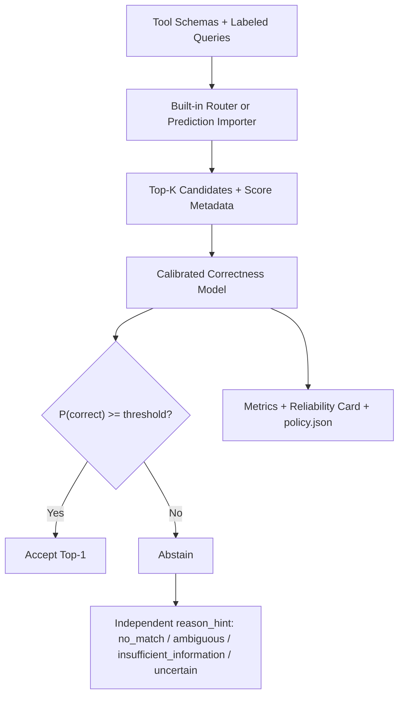

# MCP Route Reliability Lab — V1.0 设计与实施文档（规格修订 1.1）

> **一句话定位：** 在部署前测量 MCP Tool Router 何时应当拒绝决策，并导出可在运行时应用的轻量策略。
>
> **English tagline:** Measure when your MCP tool router should abstain — before deployment.

## 0. 项目摘要

| 项目项 | 说明 |
|---|---|
| 仓库名 | `mcp-route-reliability` |
| Python 包名 | `mcp_route_reliability` |
| 项目类型 | Agent Infrastructure / Evaluation / Reliability |
| 核心定位 | Router-agnostic reliability layer for MCP tool routing |
| 目标用户 | 使用大量 MCP Tools 的 Agent 开发者、评测人员和平台工程师 |
| 主要用途 | GitHub 开源作品、Agent 方向求职项目、可复现实验项目 |
| 建议周期 | 8 周，每天 2–3 小时 |
| 最低可交付版本 | 4 周完成 V0.1，先证明问题成立 |
| 默认环境 | Python 3.11、CPU 可运行；GPU 仅用于加速 |
| 目标产品版本 | V1.0 |

本项目不是再开发一个“更强的 Tool Router”，而是构建一个可以评测现有 Router、并导出轻量运行时策略的可靠性工具包：

```text
Existing Router
    ↓
Top-K tools + score metadata
    ↓
Reliability Layer
    ├── Accept：允许 Agent 使用 Top-1 Tool
    └── Abstain：拒绝执行，并附带 reason_hint
```

核心产品形态可以概括为：

> **Pytest for MCP Tool Routing Reliability**

开发者无需迁移到本项目的 Router，只需导出 Top-K 预测，即可评测其路由准确率、校准误差、拒绝能力、风险—覆盖率和分布变化下的稳定性。系统还可导出带适用范围与数据哈希的 policy.json，由纯函数 SDK 应用于同一 Router、Tool Corpus 和近似查询分布；它不是在线网关，也不提供跨分布的风险保证。

---

## 1. 为什么值得做

当 Agent 连接几十或上百个 Tools 时，把全部 Tool Schema 一次性放入模型上下文会增加 Token、延迟和工具混淆风险。Tool Retrieval、Semantic Routing、MCP Gateway 和大型 Tool-use Benchmark 已经有较成熟的开源实现，因此单纯重复 BM25、Embedding、Hybrid 或 Cross-encoder 的 Top-K Router，差异化有限。

真正仍有工程价值的问题是：

1. Router 的最高相似度 `0.82` 是否真的意味着约 82% 的正确概率？
2. Top-1 和 Top-2 非常接近时，Agent 应直接执行还是先澄清？
3. 当前工具集合根本无法完成请求时，Router 能否返回 `no_match`，而不是硬选一个工具？
4. Router 在英文数据上表现良好，换成中文、口语、错别字或退化的 Tool Schema 后是否仍可靠？
5. 当开发者要求“已自动执行请求的错误率不超过 5%”时，系统应使用什么阈值，能覆盖多少请求？

这些问题分别对应：

- Confidence Calibration；
- Ambiguity Detection；
- No-match / Out-of-Scope Detection；
- Distribution Shift / Robustness；
- Selective Prediction / Risk-Coverage Trade-off。

### 1.1 竞争边界

| 现有方向 | 已解决的主要问题 | 本项目不正面竞争的部分 | 本项目切入点 |
|---|---|---|---|
| Semantic Tool Router | BM25、Embedding、Hybrid、Reranker、Top-K | 不追求新的通用检索算法 | Router 输出是否可信 |
| MCP Gateway | Server 注册、流量路由、会话和生命周期 | 不做 Kubernetes 网关 | 路由决策的离线可靠性验证 |
| MCPToolBench++ | 大规模 Tool Discovery、Selection、Invocation | 不追求更大的通用 Benchmark | Calibration、Abstention、No-match、Risk-Coverage |
| AgentAbstain | 完整 Agent 何时不应行动 | 不评测完整 Agent 轨迹和运行时行为 | 执行前的 Tool Router 决策可靠性 |

因此 README 不应宣传“第一个 Tool Router”或“第一个 Agent Abstention 项目”，而应明确写成：

> **A router-agnostic reliability and selective-prediction layer for pre-execution MCP tool routing.**

---

## 2. 核心研究问题

V1.0 只回答以下五个问题：

### RQ1：原始 Router 分数是否校准？

比较未校准的 Router 置信代理、Isotonic Regression 和 Logistic Confidence Model 的概率质量。Min-Max 只作为分数缩放基线，其参数必须仅在 Calibration Split 上拟合，且不得把缩放后的分数称为概率。

### RQ2：拒绝低置信度请求能降低多少路由风险？

在不同 Coverage 下计算 Selective Risk，并回答：

> 当经验目标错误率设为 5% 时，Router 最多能自动处理多少请求；相应的一侧 95% 置信上界和有效接受样本数是多少？

5% 是实验目标而非安全保证。如果 Calibration Split 上不存在满足最低接受样本数和置信上界约束的阈值，系统必须明确报告“无可用保守阈值”。

### RQ3：能否识别 No-match 与 Ambiguous 查询？

将“没有可用工具”和“信息不足、无法区分工具”从普通路由错误中单独建模。

### RQ4：语言和 Schema 变化会造成多大退化？

比较中文/英文、语义改写、表面噪声以及 Tool 描述退化前后的成对性能差异。

### RQ5：简单可解释的可靠性方法是否足够有用？

比较单阈值、Margin、Isotonic 和 Logistic 方法，避免为了“模型复杂”而引入不适合小数据的深度模型。

---

## 3. V1.0 产品目标与非目标

### 3.1 必须实现

1. 一份中英双语、包含 Hard Negative、No-match 和 Clarification 的小型公开数据集。
2. BM25 与多语言 Embedding 两个内置基线。
3. Router-agnostic JSONL Prediction Importer，可导入任意外部 Router 的 Top-K 结果及分数语义。
4. 原始路由指标、校准指标、选择性预测指标和分组 Bootstrap 置信区间。
5. Threshold、Margin、Isotonic 和 Logistic 四类可靠性策略。
6. Reliability Diagram、Risk-Coverage Curve 和逐条失败报告。
7. 一个可在 CI 中运行的 CLI 与最小 Python SDK。
8. Dataset Card、Reliability Card、实验 Manifest、policy.json 和可复现命令。
9. 第二位人工标注者独立复核 100 条分层样本，并公开一致性与分歧裁决方法。
10. Paraphrase、Cross-language、Noise 三类配对扰动全部完成。

### 3.2 有时间再做

- Hybrid Router；
- Semantic Tool Router 专用 Adapter；
- Tool Schema 扰动；
- Streamlit 只读 Dashboard；
- Docker 镜像；
- 云端 LLM Router 对照组。

### 3.3 V1.0 明确不做

- 不执行真实 Tool；
- 不生成 Tool 参数；
- 不评测多步 Agent 轨迹；
- 不做 MCP Server 生命周期管理；
- 不做权限、安全网关或沙箱；
- 不做 FastAPI 在线服务；
- 不做多 Agent 编排；
- 不训练 Embedding Model、Cross-encoder 或 LLM；
- 不做在线漂移监控和自动再校准；
- 不宣称提供形式化安全保证。

这些边界不是功能缺失，而是保证项目能由一名本科生独立完成、讲清楚并验证扎实。

---

## 4. 用户使用流程



标准流程：

1. 加载 Tool Corpus 和标注查询。
2. 运行内置 Router，或导入外部 Router 的预测。
3. 保存每条查询的 Top-K、原始分数和延迟。
4. 从 Top-K 结果提取可解释的置信特征。
5. 只在 Calibration Split 上拟合校准器、原因诊断器和选择阈值；真实标签不得进入推理特征。
6. 在冻结 Test Split 上评测路由、校准、接受/拒绝和原因诊断效果。
7. 生成 metrics.json、图表、错误案例、Reliability Card 和绑定适用范围的 policy.json。
8. 开发者只能在 Router 版本、Tool Corpus 与查询分布近似一致时复用策略；任何变化都需要重新校准。

示例 CLI：

```bash
mrrl validate --tools data/tools.json --queries data/queries.jsonl

mrrl benchmark \
  --router embedding \
  --tools data/tools.json \
  --queries data/queries.jsonl \
  --output runs/embedding-v1

mrrl calibrate \
  --run runs/embedding-v1 \
  --method logistic \
  --max-risk 0.05 \
  --min-accepted 30

mrrl report --run runs/embedding-v1
```

外部 Router：

```bash
mrrl benchmark \
  --predictions external/router-output.jsonl \
  --queries data/queries.jsonl \
  --output runs/external-router
```

---

## 5. 系统架构

```text
src/mcp_route_reliability/
├── models.py              # 核心 Pydantic 数据模型
├── loaders.py             # Tool、Query、Prediction 加载与验证
├── routers/
│   ├── base.py            # Router Protocol
│   ├── bm25.py            # 词法基线
│   └── embedding.py       # 多语言向量基线
├── importers/
│   └── jsonl.py           # 已有外部预测的导入与验证
├── confidence/
│   ├── features.py        # Top-1、Margin、Entropy 等特征
│   ├── calibrators.py     # Isotonic / Logistic
│   ├── policies.py        # Accept / Abstain
│   └── reasons.py         # 独立的拒绝原因诊断
├── evaluation/
│   ├── ranking.py         # Accuracy、Recall@K、MRR
│   ├── calibration.py     # ECE、Brier
│   ├── selective.py       # Risk、Coverage、AURC
│   └── groups.py          # 分语言、类型和难度分析
├── reporting/
│   ├── plots.py
│   └── reliability_card.py
├── runtime.py             # 纯函数 apply_policy，不提供在线服务
└── cli.py

data/
├── tools.json
├── queries.jsonl
├── annotations/
├── sources.csv
└── DATASET_CARD.md

tests/
├── unit/
├── integration/
└── fixtures/

runs/                     # 默认不提交大体积中间文件
docs/
├── design.md
├── annotation-guide.md
└── reliability-card-example.md
```

设计原则：

- CLI 只做参数解析，业务逻辑全部进入 SDK；
- Dashboard 或报告只读取标准产物，不复制评测逻辑；
- 所有输入输出带 `schema_version`；
- 所有随机过程固定种子；
- Test Split 不参与阈值选择和特征筛选。

---

## 6. 数据模型

### 6.1 ToolRecord

```json
{
  "schema_version": "1.0",
  "tool_id": "github.search_code",
  "name": "search_code",
  "description": "Search code across GitHub repositories.",
  "input_schema": {},
  "server": "github",
  "domain": "developer_tools",
  "source_url": "https://github.com/...",
  "source_commit": "...",
  "license": "MIT"
}
```

### 6.2 QueryCase

```json
{
  "schema_version": "1.0",
  "query_id": "q_001",
  "base_query_id": "q_001",
  "text": "帮我在仓库中搜索包含 FastAPI 的 Python 代码",
  "language": "zh",
  "case_type": "clear",
  "difficulty": "medium",
  "relevant_tool_ids": ["github.search_code"],
  "should_abstain": false,
  "abstain_reason": null,
  "split": "test"
}
```

`case_type` 只允许：

- `clear`：存在清晰的主要 Tool；
- `hard_negative`：多个语义相似 Tool，需要细粒度区分；
- `multi_valid`：多个 Tool 均可接受；
- `clarify`：信息不足，应先向用户提问；
- no_match：当前固定版本的 Tool Corpus 无法完成请求。

abstain_reason 只允许 no_match、ambiguous 或 insufficient_information。case_type=clarify 时，abstain_reason 必须是 ambiguous 或 insufficient_information；case_type=no_match 时必须是 no_match。

should_abstain、abstain_reason、case_type 和 relevant_tool_ids 是训练/评测标签，严禁进入推理特征或运行时决策函数。no_match 始终相对于 tool_corpus_hash 指向的语料库快照定义；clarify 必须在存在相关能力但缺少必要槽位或消歧信息时使用。

### 6.3 RouterPrediction

```json
{
  "schema_version": "1.1",
  "query_id": "q_001",
  "router_id": "example-router",
  "router_version": "2.0.0",
  "tool_corpus_hash": "sha256:...",
  "query_set_hash": "sha256:...",
  "score_metadata": {
    "score_type": "similarity",
    "higher_is_better": true,
    "comparable_across_queries": false
  },
  "candidates": [
    {"tool_id": "github.search_code", "score": 0.81, "rank": 1},
    {"tool_id": "github.search_repo", "score": 0.78, "rank": 2}
  ],
  "latency_ms": 28.4,
  "error": null
}
```

score_type 只允许 similarity、logit、distance 或 rank_only。Importer 必须验证排序方向、重复候选、Tool ID、语料库哈希和查询集哈希。缺少哈希或分数语义的外部结果不得进入校准实验。

若外部 Router 只提供排名、不提供可比较分数：

- 仍计算 Top-1、Recall@K 和 MRR；
- 不伪造概率；
- Calibration 和 Risk-Coverage 标记为 not_available。

每个校准器绑定到 router_id、router_version、tool_corpus_hash、feature_version 和 score_metadata。任何一项变化都必须重新校准。

### 6.4 ReliabilityDecision

```json
{
  "query_id": "q_001",
  "top1_tool_id": "github.search_code",
  "estimated_correctness": 0.41,
  "decision": "abstain",
  "reason": "confidence_below_threshold",
  "reason_hint": "ambiguous",
  "policy_id": "policy_embedding_v1",
  "threshold": 0.87
}
```

正式决策只有 accept 与 abstain。reason_hint 由独立诊断器产生，可取 no_match、ambiguous、insufficient_information 或 uncertain；它不改变主接受/拒绝决策，也不得读取 QueryCase 的真实标签。

### 6.5 PolicyArtifact

policy.json 至少记录 policy_id、Router 与模型版本、Tool Corpus 哈希、Calibration Dataset 哈希、Feature Version、Score Metadata、校准方法、接受阈值、目标经验风险、最低接受样本数、Calibration 样本数、置信区间方法和生成 Commit。Calibration Dataset 哈希用于可追溯性，不要求新的运行时 Query 属于旧查询集；运行时必须验证 Router、Tool Corpus、Feature Version 和 Score Metadata，任一不匹配时默认拒绝加载。

---

## 7. 数据集范围

### 7.1 V0.1：最小证明集

| 内容 | 数量 |
|---|---:|
| Tools | 20 |
| 基础查询 | 100 |
| Router | BM25、Embedding |
| Query 类型 | Clear、Hard Negative、Clarify、No-match |
| 输出 | Accuracy、ECE、Risk-Coverage、错误案例 |

V0.1 的目标不是发布“权威 Benchmark”，而是验证三个现象：

1. 原始相似度不等于正确概率；
2. 低 Margin 样本更容易选错；
3. 拒绝一部分请求可以显著提高 Accepted Accuracy。

V0.1 只产生探索性结果，不发布稳定的 5% 风险阈值，也不将同一批数据同时用于选阈值和宣称最终泛化性能。

### 7.2 V1.0：公开发布集

建议使用 40–60 个 Tools 和 300 条基础查询：

| 类型 | 数量 | 预期行为 |
|---|---:|---|
| 清晰单工具查询 | 100 | 选择正确 Tool |
| 相似工具困难样本 | 60 | 区分 Hard Negative |
| 多工具均可接受 | 20 | 命中任一有效 Tool |
| 信息不足需澄清 | 60 | abstain，诊断为 clarify |
| 无匹配工具 | 60 | abstain，诊断为 no_match |
| 合计 | 300 | — |

语言比例为中文 50%、英文 50%。这是为了覆盖失败场景而设计的压力测试分布，不代表真实生产流量中的类别比例。Dataset Card 和 Reliability Card 必须报告各类别占比，并声明校准概率与阈值会随类别先验和查询分布变化。

### 7.3 配对扰动

从 Test Split 分层选择 30 条基础查询，每条生成并人工确认三种变体：

1. 同语言语义改写；
2. 中英文跨语言表达；
3. 错别字、口语或轻微噪声。

共形成 90 条配对扰动。三种扰动均属于 V1.0 必做项。配对版本必须与 Base Query 位于同一 Split，统计时以 base_query_id 为重采样单位。

### 7.4 数据切分

| Split | 基础查询数 | 用途 |
|---|---:|---|
| Development | 100 | 开发 Loader、Router 和候选置信特征 |
| Calibration | 100 | 拟合校准器、原因诊断器和选择阈值 |
| Test | 100 | 只用于最终报告 |

约束：

- 同一 base_query_id 的所有变体必须在同一 Split；
- 按语言、Case Type、难度和 Tool Domain 分层；
- 不在 Test 结果上反复调整特征、超参数或阈值；
- 如修复 Test 标签错误，提升数据集版本并重新运行全部最终实验；
- 三个 Split 共享同一 Tool Corpus，因此 V1.0 只评测已知工具集合上的 Query 泛化，不支持“未见 Tool 冷启动”结论；
- 校准策略仅适用于相同 Router 版本、Tool Corpus 和近似查询分布。

### 7.5 标注质量

V1.0 必做：

- 发布可操作的标注指南；
- 每条数据保存标签依据、候选冲突说明和所依据的 Tool Corpus 哈希；
- 对所有 clarify、no_match 和 Hard Negative 进行二次自查；
- 第二位人工标注者独立复核 100 条分层样本，不查看第一标注结果；
- route/abstain 报告 Cohen's Kappa，多标签 Tool 集合报告 Jaccard 或集合一致率；
- 保存两位标注者的原始结果和分歧记录，裁决结果写入独立字段；
- 用脚本检查 Tool ID、Split、空标签、重复文本和 Base Query 泄漏。

若第二标注者未完成，版本只能发布为单人标注的候选版，不得标记为 V1.0 稳定 Benchmark。

---

## 8. Router、Prediction Importer 与运行时协议

### 8.1 内置 Router

V1.0 必须：

- BM25；
- 多语言 Sentence Transformer + Cosine Similarity。

可选：

- Reciprocal Rank Fusion 或加权 Hybrid；
- Cross-encoder Reranker；
- LLM Selector。

内置 Router 的作用是产生可复现基线和展示完整流程，不作为主要创新点。

### 8.2 Prediction Importer 是一级功能

外部 Router 支持不应放在项目角落，而应成为 README 第一屏的核心卖点。Prediction Importer 负责：

1. 校验 Query ID、Tool ID、Tool Corpus 哈希和查询集哈希；
2. 校验候选排名是否重复、缺失或方向错误；
3. 保留 Router 原始分数及 score_metadata，不擅自解释；
4. 将已有预测转换成统一 RouterPrediction；
5. 对 rank_only 结果禁用概率实验；对不可跨查询直接比较的分数，只允许使用在 Calibration Split 上拟合并记录版本的 Router 专属变换。

运行 Router 与导入已有预测是两个不同接口：

```python
from pathlib import Path
from typing import Iterable, Protocol

class Router(Protocol):
    def rank(self, query: QueryCase, tools: list[ToolRecord], top_k: int) -> RouterPrediction:
        ...

class PredictionImporter(Protocol):
    def load(
        self,
        path: Path,
        expected_tool_corpus_hash: str,
        expected_query_set_hash: str,
    ) -> Iterable[RouterPrediction]:
        ...
```

V1.0 发布后可增加 Semantic Tool Router 的示例转换器，但不要把第三方项目变成核心依赖。

### 8.3 轻量运行时协议

SDK 提供纯函数 apply_policy(prediction, policy) -> ReliabilityDecision。它不启动服务、不执行 Tool，也不访问真实标签。Router 版本、Tool Corpus 哈希、Feature Version 或 Score Metadata 与 policy.json 不匹配时必须 fail closed，返回策略不适用错误。

---

## 9. 置信特征、校准与决策

### 9.1 第一版特征

只使用容易解释、面试时能讲清楚且推理时可观测的特征：

- top1_score 及由 Calibration Split 拟合的标准化值；
- top1_minus_top2；
- 对 Top-K 分数应用明确 Softmax 变换后的熵；
- 在 Calibration Split 拟合尺度后的 Top-K 离散程度；
- Query 长度和语言；
- Tool 描述长度与缺失状态；
- Query 与 Tool Name/Description 的词汇覆盖；
- BM25 与 Embedding 的 Top-1 是否一致。

不使用不稳定的 top1_div_top2。所有特征的定义、变换参数与版本必须写入 Manifest；真实标签、case_type、should_abstain 和 abstain_reason 不得作为推理特征。

### 9.2 方法

| 方法 | 输入 | 作用 | 是否必做 |
|---|---|---|---|
| Max-score Threshold | Top-1 分数 | 最简单基线 | 是 |
| Margin Threshold | Top-1 - Top-2 | 检测候选接近 | 是 |
| Isotonic Regression | 单一 Router 分数 | 非参数概率校准 | 是 |
| Logistic Confidence Model | 4–6 个可解释特征 | 预测 Top-1 是否正确 | 是 |
| Deep Confidence Model | 多特征 | 更复杂错误预测 | 否 |

校准器的目标变量是：

```text
y = 1  当 Top-1 Tool 属于 relevant_tool_ids 且该样本不应 abstain
y = 0  其他情况
```

所有参数只在 Calibration Split 上学习。Logistic 使用 L2 正则，特征集合只能依据 Development Split 确定。Isotonic 必须报告有效样本数和唯一分数数；若条件不足则标记 not_available，不得强行拟合。

### 9.3 主决策与原因诊断

V1.0 将“是否执行”和“为什么拒绝”严格分开：

1. 校准器只输出 P(top1_correct)；
2. 当概率高于冻结阈值时输出 accept；
3. 否则统一输出 abstain；
4. 独立原因诊断器仅基于可观测特征产生 reason_hint；
5. reason_hint 可为 no_match、ambiguous、insufficient_information 或 uncertain，但不改变主决策。

原因诊断器可使用正则化多项 Logistic 或显式规则，并只在 Calibration Split 拟合。No-match 与 Clarification 的 Precision、Recall、F1 属于原因诊断指标，而不是底层 Router 自带能力。标签只用于训练与评测，运行时不可读取。

### 9.4 目标风险阈值

给定经验目标 max_risk = 0.05：

1. 在 Calibration Split 上枚举置信阈值；
2. 对每个阈值计算 Coverage、Accepted Error Rate、接受样本数及一侧 95% Wilson 风险上界；
3. 丢弃接受样本数少于 30 的候选阈值；
4. 选择满足经验 risk <= 0.05 时 Coverage 最大的 empirical_policy；
5. 若存在风险置信上界 <= 0.05 的阈值，额外导出 conservative_policy；不存在时明确报告无可用保守阈值；
6. 冻结策略与所有哈希，在 Test Split 上一次性报告真实 Risk、Coverage 和区间，不保证 Test Risk 必然低于 5%。

策略只对相同 Router、模型版本、Tool Corpus、Feature Version 和近似类别先验成立。V1.0 不提供有限样本下的形式化风险保证。

---

## 10. 评测指标

### 10.1 路由质量

- Top-1 Accuracy；
- Recall@3、Recall@5；
- MRR；
- Multi-valid Hit Rate；
- No-match Precision、Recall、F1；
- Clarification Precision、Recall、F1。

NDCG 可作为增强项，不进入最低完成标准。

### 10.2 概率质量

- Expected Calibration Error；
- Brier Score；
- Reliability Diagram；
- Error Detection AUROC，并明确将“路由错误”作为正类。

Brier Score 作为主要概率质量指标。ECE 默认使用 5 个等频分箱，同时公开 Bin 数、边界和每箱样本量；样本不足的子组不单独报告 ECE。另按语言与 Case Type 报告 Brier 和经验风险，避免总体校准掩盖子组失准。

### 10.3 选择性预测

- Coverage；
- Selective Accuracy；
- Selective Risk；
- Risk-Coverage Curve；
- Area Under the Risk-Coverage Curve，数值越低越好；
- Coverage at Target Risk。

其中：

```text
Coverage = 被系统接受的查询数 / 全部查询数

Selective Risk = 被接受查询中的错误数 / 被接受查询数
```

### 10.4 稳健性

- Base Query 与改写版本的 Accuracy 差值；
- Base Query 与跨语言版本的差值；
- Base Query 与噪声版本的差值；
- 置信度变化；
- 决策翻转率：`accept ↔ abstain`；
- Top-1 Tool 翻转率。

主要指标必须使用按 base_query_id 分组的 Bootstrap 置信区间，默认至少 1,000 次重采样，不能把一个查询的多个变体当作完全独立样本。

---

## 11. 核心实验

V1.0 README 只需要重点讲清楚四组实验。

### 实验 A：分数不是概率

对每个 Router 绘制 Reliability Diagram，并对比：

- 明确记录变换方式的未校准置信代理；
- Isotonic 校准概率；
- Logistic Confidence Model 概率。

回答：Router 分数能否跨查询解释？在相同 Router 和 Tool Corpus 下，校准后 Brier 与 ECE 是否下降？不得把 BM25、距离或任意缩放分数直接称为正确概率。

### 实验 B：风险—覆盖率权衡

绘制 Risk-Coverage Curve，并报告：

| Policy | Accepted N | Coverage | Accepted Accuracy | Selective Risk | 95% Risk UCB |
|---|---:|---:|---:|---:|---:|
| Always Accept | 实验结果 | 100% | 实验结果 | 实验结果 | 实验结果 |
| Max-score | 实验结果 | 实验结果 | 实验结果 | 实验结果 | 实验结果 |
| Margin | 实验结果 | 实验结果 | 实验结果 | 实验结果 | 实验结果 |
| Calibrated Logistic | 实验结果 | 实验结果 | 实验结果 | 实验结果 | 实验结果 |

禁止提前填写理想数字。README 中的所有结果必须来自冻结测试集；若不存在满足保守风险约束的策略，应直接报告不存在。

### 实验 C：Abstention 与原因诊断

主决策先报告 accept/abstain 的 Precision、Recall、Coverage 和 Risk；独立原因诊断器再报告：

- no_match reason_hint 的 Precision、Recall、F1；
- insufficient_information / ambiguous reason_hint 的 Precision、Recall、F1；
- uncertain 的数量与比例；
- 最常见误判对；
- 高置信错误案例。

原因诊断结果不得反向改变已冻结的 accept/abstain 主决策。

### 实验 D：Distribution Shift

比较 Base、Paraphrase、Cross-language 和 Noise 四类条件，重点展示：

- Accuracy Drop；
- Brier 与 ECE 变化；
- Top-1 Flip Rate；
- Acceptance Decision Flip Rate；
- 分语言与 Case Type 的经验风险差异。

---

## 12. 实验产物

每次运行生成：

```text
runs/<run-id>/
├── run-manifest.json
├── predictions.jsonl
├── confidence-features.parquet
├── metrics.json
├── errors.csv
├── policy.json
├── reliability-card.md
└── figures/
    ├── reliability-diagram.png
    ├── risk-coverage.png
    └── group-comparison.png
```

`run-manifest.json` 至少包含：

- Git Commit；
- 数据集版本及哈希；
- Tool Corpus 版本及哈希；
- Router 和模型完整名称；
- Score Metadata、Feature Version 与 Prediction Importer Version；
- Calibrator、原因诊断器、阈值、目标风险和最低接受样本数；
- 类别比例及 Calibration/Test 有效样本数；
- 随机种子；
- Python 和依赖版本；
- 开始、结束时间；
- 运行状态和错误信息。

Reliability Card 必须说明：

1. 评测对象、Tool Corpus 哈希、Router/模型版本和数据范围；
2. Benchmark 类别比例与它和生产流量可能存在的差异；
3. 推荐阈值、Calibration 样本数、经验风险和一侧 95% 风险上界；
4. 冻结 Test 上的真实 Risk、Coverage、接受样本数和 Bootstrap 区间；
5. 最容易失败的 Query 类型、语言与 Schema 局限；
6. 阈值仅适用于相同 Router、Tool Corpus 和近似查询分布；
7. 不得将本报告解释成安全认证。

---

## 13. 测试、CI 与复现

### 13.1 测试范围

- 数据模型和 Schema Validation；
- Top-K 排序、重复 Tool 和空候选；
- Accuracy、MRR、ECE、Brier、Coverage 和 Risk；
- 阈值、特征选择和原因诊断器不得读取 Test Split；
- 真实标签字段不得进入推理特征；
- Prediction Importer 对损坏输入、哈希不匹配、未知 Score Type 和排序方向错误给出明确错误；
- apply_policy 对 Router/Tool Corpus/Feature Version 不匹配必须 fail closed；
- 10 Tools × 20 Queries 的端到端集成测试；
- CLI 退出码和输出文件；
- 固定 Fixture 的 Golden Metrics。

### 13.2 CI

GitHub Actions 只运行：

```text
Install
  ↓
Ruff
  ↓
Mypy
  ↓
Pytest
  ↓
Tiny end-to-end benchmark
```

公共 CI 不依赖 GPU、云端 API Key 或大型模型下载。Embedding 集成测试使用小型 Fixture 或 Mock；完整 Benchmark 在本地运行并提交 Manifest 与最终报告。

### 13.3 技术栈

- Python 3.11；
- Pydantic、Typer；
- scikit-learn；
- pandas、NumPy、PyArrow；
- rank-bm25 或等价 BM25 实现；
- sentence-transformers；
- Matplotlib 或 Plotly；
- pytest、Ruff、mypy；
- `uv` 管理依赖和锁文件。

Streamlit、Docker 和云端 LLM SDK 均为可选依赖，不进入核心安装。

---

## 14. 八周开发路线

### 第 1 周：先做 3-Tool Mini Agent 学习闭环

这部分不进入最终项目核心代码，但必须帮助开发者理解：

```text
User → LLM → Tool Selection → Tool Result → Final Answer
```

学习并实践 JSON、HTTP、LLM API、Function Calling、Tool Calling 和最小 Agent Loop。只使用 calculator、weather、time 三个 Tool。

**验收：** 能独立解释 Query 如何变成 Tool Name 与 Arguments，以及为什么 Tool Selection 和 Tool Execution 是两个问题。

### 第 2 周：V0.1 数据与 BM25

- 定义 ToolRecord、QueryCase、RouterPrediction；
- 收集 20 个 Tools；
- 标注 100 条最小查询；
- 实现 Loader、Validator 和 BM25；
- 实现 Top-1、Recall@K、MRR；
- 跑通 CLI 最小闭环。

**验收：** 一条命令可输出逐条预测和基础指标。

### 第 3 周：Embedding 与 Prediction Importer

- 实现多语言 Embedding Router；
- 完成 JSONL Prediction Importer、哈希校验与 Score Metadata；
- 增加 Hard Negative、Clarify、No-match；
- 生成 BM25 与 Embedding 对比表；
- 写第一版错误分析。

**验收：** 任意符合 Schema、哈希和分数语义约束的外部 Top-K 结果都能进入适用的评测流程。

### 第 4 周：Reliability V0.1

- 提取 Top-1、Margin、归一化 Entropy 等特征；
- 实现 ECE、Brier、Reliability Diagram；
- 实现 Coverage、Selective Risk 和 Risk-Coverage Curve；
- 完成 Max-score 与 Margin 两个策略；
- 发布仅用于验证问题的探索性 V0.1。

**验收：** 用真实图表证明“Router 分数不等于正确概率”和“拒绝可以降低经验风险”，但不发布稳定的 5% 风险承诺。

### 第 5 周：扩展到 V1.0 数据

- Tool Corpus 扩展到 40–60；
- 基础查询扩展到 300；
- 完成 100/100/100 分层切分；
- 第二标注者独立复核 100 条分层样本；
- 完成标注二次自查并冻结 Test Split。

**验收：** Dataset Card、来源清单、类别比例、标注指南和原始分歧记录齐全，Validator 全部通过。

### 第 6 周：校准、拒绝与原因诊断

- 实现 Isotonic Regression；
- 实现带 L2 正则的 Logistic Confidence Model；
- 完成经验阈值、最低接受样本数和一侧 95% 风险上界计算；
- 主决策只输出 accept/abstain；
- 实现独立 reason_hint 诊断器；
- 导出带适用范围的 policy.json；
- 冻结实验配置。

**验收：** Calibration Split 产生的策略可无修改应用到 Test Split，版本或哈希不匹配时运行时函数 fail closed。

### 第 7 周：扰动、统计与报告

- 完成 90 条 Paraphrase、Cross-language、Noise 配对扰动；
- 运行全部三类扰动实验；
- 完成按 base_query_id 分组的 Bootstrap 置信区间；
- 完成第二标注分歧裁决、一致性报告和分组错误分析；
- 完成 Reliability Card；
- 有余力再加入 Tool Schema 扰动。

**验收：** 能回答 Router 在哪些变化下会高置信选错，并给出效果量、样本数和不确定性。

### 第 8 周：工程化与求职包装

- 完成单元测试、集成测试、标签泄漏测试和策略适用范围测试；
- 配置 Ruff、mypy、pytest、GitHub Actions；
- 完成 README、架构图、许可证和复现命令；
- 一次性运行冻结 Test 并填入真实结果；
- 验证 apply_policy 纯函数和 policy.json；
- 准备 2 分钟演示视频和简历描述；
- 有余力再做 Streamlit 与 Docker。

**验收：** 新用户在干净 CPU 环境中能安装、运行 Tiny Benchmark、生成报告，并安全加载适用的策略文件。

---

## 15. 优先级与降级规则

优先级从高到低：

1. 数据定义、双人标注与标签质量；
2. Prediction Importer、Score Metadata 与哈希校验；
3. Calibration、Risk-Coverage 和策略适用范围；
4. Accept/Abstain 与独立原因诊断；
5. 测试、Manifest、Dataset Card、Reliability Card 和 policy.json；
6. 三类配对扰动与分组 Bootstrap；
7. Dashboard；
8. Docker；
9. 云端 LLM 对照组。

如果延期：

- 先删除 LLM Router、Dashboard 和 Docker；
- 再删除 Tool Schema 扰动；
- 不删除 Prediction Importer、双人标注、Bootstrap、Calibration、Risk-Coverage 和主 Accept/Abstain 决策；
- 不使用 Test Split 调参；
- 不为了好看而填写未经实验验证的指标。

---

## 16. 开源、许可证与数据适用范围

- 项目原创代码采用 Apache-2.0 许可证；
- 自行创作的查询、标注指南和 Dataset Card 采用 CC BY 4.0；
- 第三方 Tool Schema 保留各自上游许可证，不得统一重新授权；
- sources.csv 必须保存仓库、Commit、抓取时间、许可证和纳入理由；
- 无法确认许可证的 Tool Schema 不进入公开数据集；
- 数据不包含 API Key、私人文件、用户聊天或个人身份信息；
- Benchmark 类别比例是压力测试设计，不代表生产流量；
- policy.json 只适用于其绑定的 Router、Tool Corpus、Feature Version 和近似查询分布。

---

## 17. 风险与缓解

| 风险 | 后果 | 缓解措施 |
|---|---|---|
| 项目退化成普通 Tool Router | 缺少差异化 | README 第一屏突出 Reliability Evaluation、Prediction Importer 和 Policy Export |
| 数据量过小 | 校准器过拟合 | 300 条基础查询、简单正则模型、最低接受样本数、Bootstrap 区间并限制结论范围 |
| 标注者偏差 | Benchmark 可信度不足 | 第二标注者独立复核 100 条，保存原始分歧、报告一致性并裁决 |
| No-match 过于简单 | 指标虚高 | 设计与现有 Tool 语义接近、但能力缺失的困难负样本 |
| 跨语言变体改变原意 | 配对标签失效 | 每条扰动人工复核，不自动继承未检查标签 |
| Calibration/Test 泄漏 | 最终数字失真 | Split 冻结、代码层校验、Manifest 记录阈值来源 |
| Score 语义不一致 | 错误比较不同 Router | 强制 Score Metadata、分数方向、哈希和每 Router 独立校准 |
| Benchmark 类别比例变化 | 阈值迁移失效 | Reliability Card 报告类别先验；Router、Corpus 或分布变化后重新校准 |
| 第三方 Schema 许可不清 | 数据无法公开 | 保存逐项来源、Commit 和 License；不明许可则移除 |
| UI 消耗时间 | 核心实验不完整 | 静态 Markdown + PNG 报告先于 Dashboard |
| 把经验阈值当成安全保证 | 误导使用者 | Reliability Card 明确样本范围与非保证性质 |

---

## 18. Definition of Done

V1.0 只有满足以下条件才算完成：

- [ ] 40–60 个来源和许可清晰的 Tool Schemas；
- [ ] 300 条中英双语基础查询和 90 条人工复核配对扰动；
- [ ] Clear、Hard Negative、Multi-valid、Clarify、No-match 五类样本齐全；
- [ ] Development、Calibration、Test 各 100 条，并按 Base Query 隔离；
- [ ] 第二标注者独立复核 100 条，保存原始结果、报告一致性并完成分歧裁决；
- [ ] BM25 与多语言 Embedding 基线可复现；
- [ ] 通用 JSONL Prediction Importer、Score Metadata 和哈希校验可用；
- [ ] Threshold、Margin、Isotonic、Logistic Confidence Model 可比较；
- [ ] Top-1、Recall@K、MRR、ECE、Brier、Risk-Coverage 已实现；
- [ ] 主要指标提供按 base_query_id 分组的 Bootstrap 区间；
- [ ] 主决策只输出 Accept/Abstain，原因诊断独立报告 No-match、Ambiguous、Insufficient Information 指标；
- [ ] Paraphrase、Cross-language、Noise 三类配对扰动全部完成；
- [ ] 经验风险策略报告 Accepted N、Risk、Coverage 和一侧 95% 风险上界；
- [ ] Test Split 只在最终配置冻结后运行；
- [ ] 生成 Manifest、Dataset Card、Reliability Card 和绑定适用范围的 policy.json；
- [ ] apply_policy 对版本或哈希不匹配 fail closed；
- [ ] 标签泄漏测试、单元测试、Tiny Integration Test 和 CI 通过；
- [ ] README 包含真实结果、失败案例、类别比例和局限性；
- [ ] 干净 CPU 环境可完成安装和最小运行；
- [ ] Apache-2.0、CC BY 4.0 与第三方 Schema 许可证边界清楚；
- [ ] 仓库不存在 API Key、私人数据或许可证不明的内容。

Dashboard、Docker、FastAPI、LLM Router、Tool Schema 扰动和 Conformal Prediction 不属于 V1.0 完成条件。

---

## 19. README 第一屏建议

```markdown
# MCP Route Reliability Lab

Measure when your MCP tool router should abstain — before deployment.

MCP Route Reliability Lab is a router-agnostic evaluation toolkit for MCP tool
routing. It measures whether routing scores are calibrated, finds empirical
accept/abstain thresholds with uncertainty estimates, diagnoses no-match and
ambiguous cases, and tests robustness across language and query shifts.

It does not replace your router or provide a safety guarantee. It exports a
version-bound policy that can be applied only to a matching router and tool corpus.
```

README 首屏应立即展示：

1. 一张 Risk-Coverage Curve；
2. 一个 `mrrl benchmark` 命令；
3. 一份简短结果卡片；
4. “imports external router predictions”的示例；
5. 与 AgentAbstain、MCPToolBench++ 和普通 Semantic Router 的边界。

---

## 20. 求职表达

### 20.1 简历项目描述

> 设计并实现面向 MCP Tool Routing 的可靠性评测工具包，支持外部预测统一导入、分数语义校验、置信度校准、选择性预测与版本绑定策略导出；构建经双人复核的中英双语 Hard Negative 数据集，通过 Brier、ECE、Risk-Coverage、Bootstrap 区间和跨语言扰动分析高置信错误，并使用冻结测试集、Manifest 与 CI 保证结果可复现。

### 20.2 面试主线

1. 为什么 Tools 增多会导致 Context 和选择问题？
2. Tool Retrieval 与 Tool Execution 有什么区别？
3. BM25 与 Embedding 分别适合什么情况？
4. 为什么余弦相似度不是正确概率？
5. 什么是 Calibration、ECE 和 Brier Score？
6. 什么是 Selective Prediction？
7. Coverage 与 Risk 如何权衡？
8. No-match 和 Ambiguous 为什么不能合并成普通错误？
9. 为什么 Calibration 与 Test 必须分开？
10. 为什么扰动版本必须和 Base Query 位于同一 Split？
11. 为什么项目优先支持 Prediction Importer，而不是发明新 Router？
12. 这个离线 Reliability Layer 不能解决哪些生产问题？

---

## 21. 后续版本

只有 V1.0 稳定后再考虑：

### V1.1

- Semantic Tool Router 专用 Adapter；
- Tool Schema 扰动；
- Streamlit Dashboard；
- Docker。

### V2.0

- Conformal Prediction / Set-valued Tool Prediction；
- 在线 Query 与 Tool Distribution Drift；
- 新增 Tool 后的持续校准；
- Agent Runtime Telemetry Adapter；
- 端到端 Agent 任务中的实际收益评估；
- 多语言扩展；
- Tool、Model、Agent、Skill 的联合路由可靠性。

V2 的重点不是继续堆 Router 算法，而是回答：

> **How reliable is tool routing when the world changes?**

---

## 22. 参考项目

- [Semantic Tool Router](https://github.com/arunmm8335/semantic-tool-router)：Tool 检索、Hybrid、Cross-encoder、MCP 与基础评测参考。
- [Microsoft MCP Gateway](https://github.com/microsoft/mcp-gateway)：MCP Gateway、Tool Gateway Router 和基础设施边界参考。
- [MCPToolBench++](https://github.com/mcp-tool-bench/MCPToolBenchPP)：大规模 MCP Tool-use Benchmark 参考。
- [AgentAbstain](https://github.com/AntiQuality/agentabstain)：完整 Agent Abstention 的相邻研究方向，用于明确本项目边界。

引用这些项目是为了说明市场位置和避免重复建设，不代表本项目依赖或复刻其代码。

---

## 23. 最终决策

这个项目值得做，但项目名称中的重点必须落在：

> **Reliability Lab**

而不是：

> 又一个 MCP Tool Router。

V1.0 最重要的三个交付物是：

1. **Prediction Importer + Policy Export**：证明项目能够服务现有 Router，并把离线校准结果安全地交付给运行时；
2. **Risk-Coverage + Calibration**：证明 Router 的分数能转化为工程决策；
3. **No-match / Clarification Benchmark**：证明系统知道什么时候不该强行选择 Tool。

只要这三件事做扎实，即使没有复杂 Dashboard、FastAPI 或 LLM Router，这仍然会是一个比普通“天气 API Agent”更有技术深度、也更适合 Agent 工程岗位面试的 GitHub 项目。
